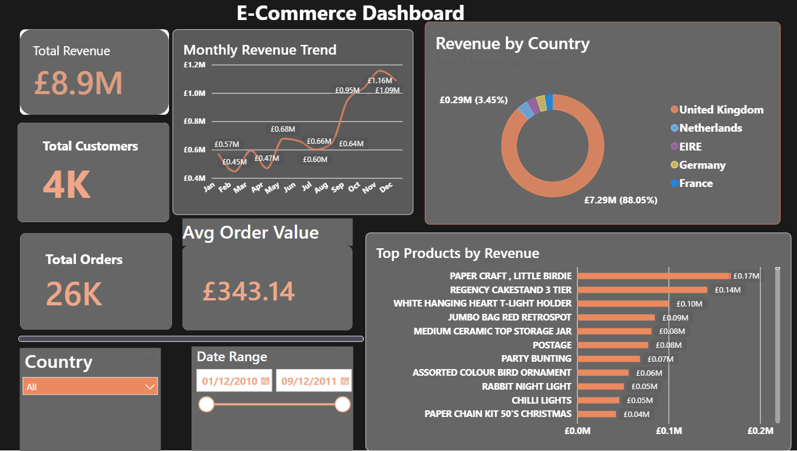

# E-Commerce Sales Dashboard (Power BI)

## Overview

An interactive Power BI dashboard of online retail transactions from 1 Dec 2010 to 9 Dec 2011. It answers three questions: how revenue changes month to month, which countries bring the revenue, and which products sell most.

## Key Metrics

| Metric | Value |
|---|---|
| Total revenue | £8.9M |
| Total orders | 26K |
| Total customers | 4K |
| Average order value | £343.14 |

## Insights

- **Revenue grows strongly in the last quarter.** Monthly revenue moves between £0.45M and £0.68M from January to August, then climbs to £0.95M in October and peaks at £1.16M in November.
- **The business depends on the UK.** The United Kingdom brings £7.29M, 88% of all revenue. The next markets (Netherlands, EIRE, Germany, France) are each a small share.
- **Gift and home décor products lead.** The top product is Paper Craft, Little Birdie (£0.17M), followed by Regency Cakestand 3 Tier (£0.14M) and White Hanging Heart T-Light Holder (£0.10M).

## Features

- Monthly revenue trend
- Revenue by country (donut)
- Top products by revenue
- Filters for country and date range

## Files

| File | Description |
|---|---|
| `ecommerce-dashboard.pbix` | Power BI file (open in Power BI Desktop) |
| `ecommerce-dashboard.png` | Dashboard screenshot |

## Tools Used

- Power BI
- Power Query
- DAX
